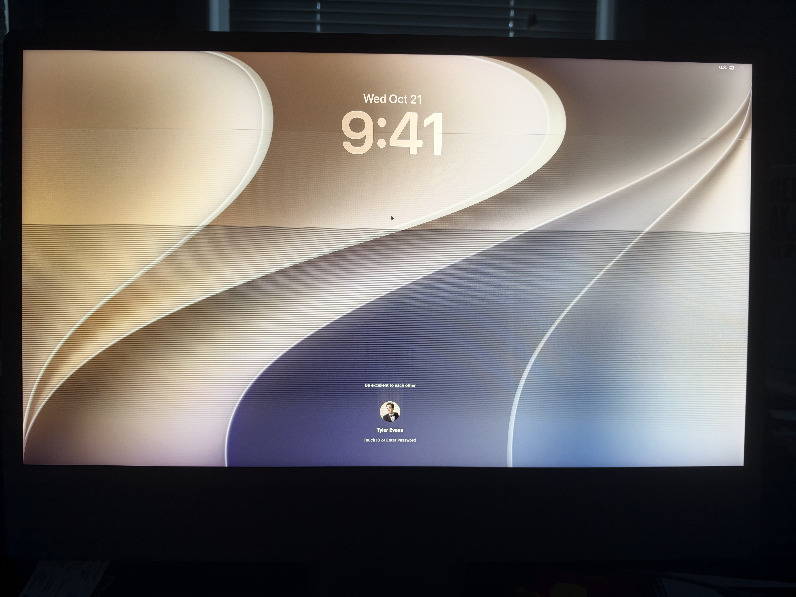

This past summer I started thinking about what my next Mac would be. I could feel my iMac struggling to keep up sometimes, and Apple's processors have improved so much since the M1. So it's been in the back of my mind that maybe 2027 would be the year I get a new Mac.

But a few weeks ago I sat down at my iMac and the screen looked like this:

I tried to take a screenshot of the problem but it doesn't show up in screenshots, which indicates that this is a problem with the actual display rather than a software glitch. I had a feeling that this was not going to be an easy fix, and any solution was going to cost some money. Regardless, I booked an appointment at the Apple Store to see what they would say.

The guy took one look at it and recognized the problem immediately. Apparently this is a known defect that happens on this model with a small number of units. I guess it's not widespread enough for a special warranty program, but it's common enough that the employees have seen it a few times. He agreed with me when I said, "So basically I just got unlucky."

The cost to repair the screen would come out to about $700. It was either that, or buy a new Mac. Considering it was already on my mind to buy a new Mac soon anyway, I decided that I didn't want to spend any money to fix something that's already on its way out. I guess the timeline for getting a new Mac has been moved up from "sometime in 2027" to "right now."

So now I have to decide what my next Mac will be, and luckily Apple had just released new processors a few months earlier so almost the entire lineup had recently been updated. I already knew I wanted a desktop; I prefer to sit at a desk with a big screen, so a MacBook isn't for me. And I knew the Mac Studio would be overkill, so I narrowed it down to the iMac or the Mac mini.

A new iMac would be simple and familiar. It would be basically the same but with a better chip. Plus it would actually be cheaper than the full Mac mini setup that I would need. And with AI inflating the cost of RAM and storage prices, it's definitely an appealing option.

The Mac mini itself would be cheaper, but I would need to buy the Studio Display with it so the total cost would end up being more expensive than the iMac. However, the Mac mini + Studio Display has one big advantage over the iMac: modularity. So if I want to buy a new Mac in the future, I wouldn't have to spend extra money to buy a whole new display with it. And if one day Apple releases a fancy new display, I wouldn't have to buy a whole new Mac just to get it. Plus the Studio Display is bigger than the iMac, so that would be an upgrade too.

Now onto the specs. My M1 iMac has 1TB of storage and 16GB of RAM. I've consistently been using about half of the available storage for a while now, so I haven't felt very constrained. On the other hand, 16GB of RAM doesn't really cut it anymore. My Mac is essentially a little home server in addition to being my primary machine, so it's often doing a lot of things at once. I'd rather save money on storage and put it into RAM.

So that day in the Apple Store, I made my decision: My next computer will be the M6 Mac mini with 1TB of storage and 32GB of RAM + Studio Display. Unfortunately that configuration was not in stock, so I walked out with the Studio Display and decided to come back for the Mac mini another time.

I set up the Studio Display directly in front of my iMac so I could still use the same computer but now with a functional screen. It was a ridiculous setup but at least it worked. I spent the next couple of weeks [preparing the way][rd] for the new Mac. When the preparations were complete and [the midterms] were over, I was ready to get a new Mac.

I picked up the Mac mini from the Apple Store on a Friday afternoon. I asked the employee about the best way to move everything from the old Mac to the new one, and he said Time Machine. I thought I would have to connect the computers together with ethernet cables or something, but this sounded way easier so I gave it a shot.

I was up and running in just a few hours. Everything came over from the old Mac; not just my files but all of my nitpicky settings too. There were a couple of small things that I had to fix for the new machine, but it was much less than I expected. It's still my Mac, just better.

I've been using this Mac mini for over a week now and it's fantastic. Going from the M1 to the M6 is a huge upgrade. The CPU is twice as fast, the memory bandwidth is twice as fast, and now I have twice as much RAM. This was all very unexpected, but I'm extremely happy with it.

[rd]: https://relay.fm/rd/102
[the midterms]: https://www.youtube.com/watch?v=aO61Eyw-jEs
